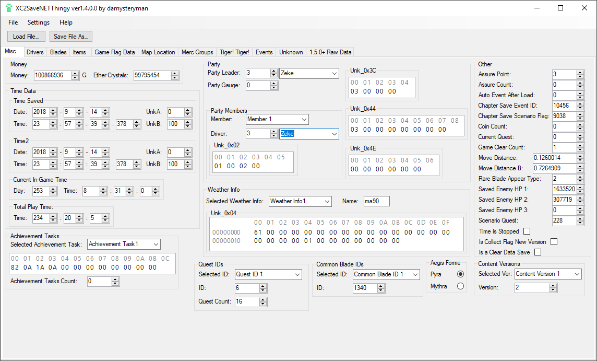
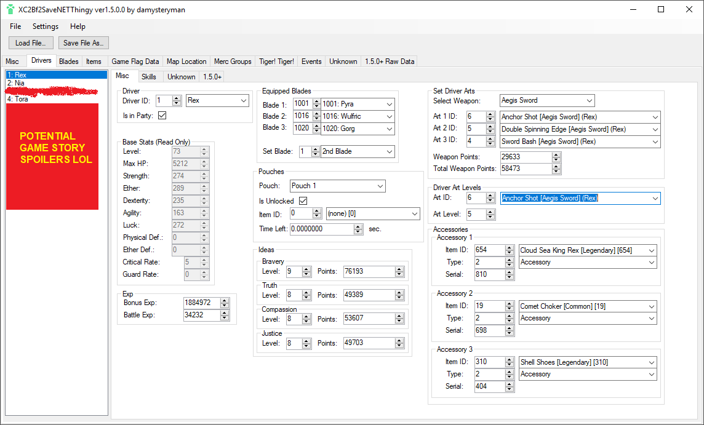
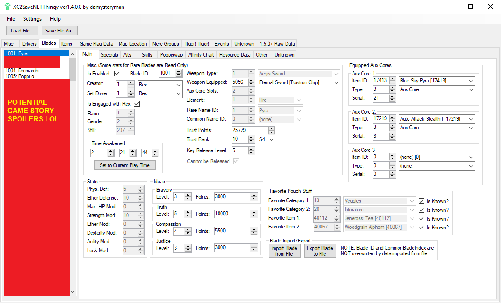
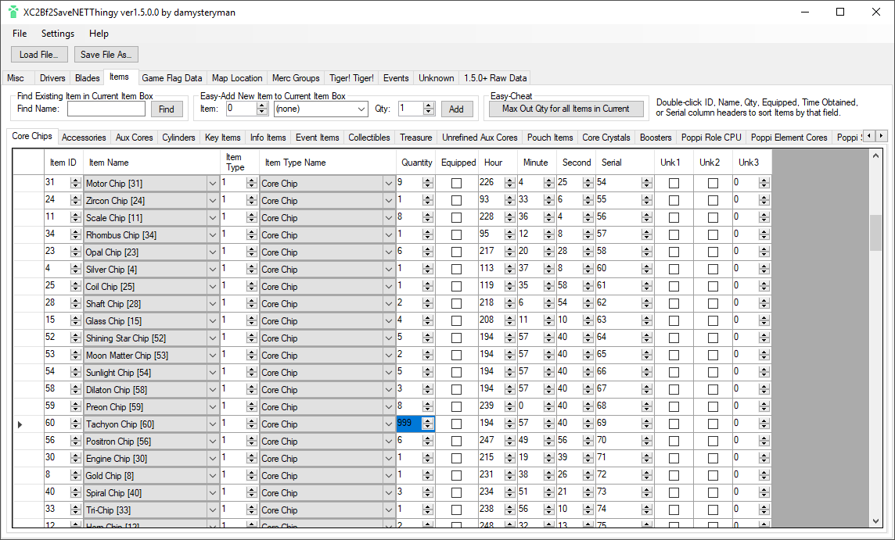
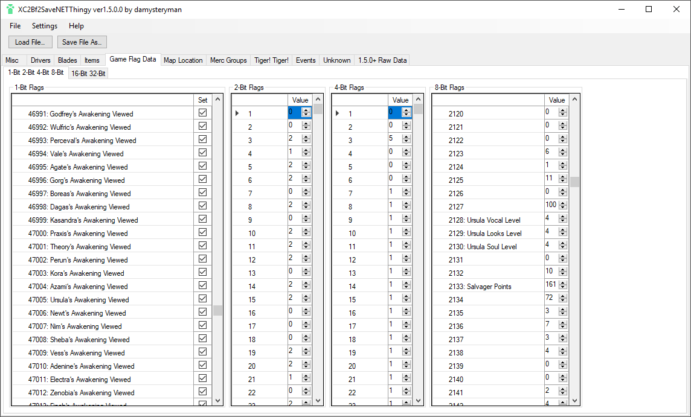
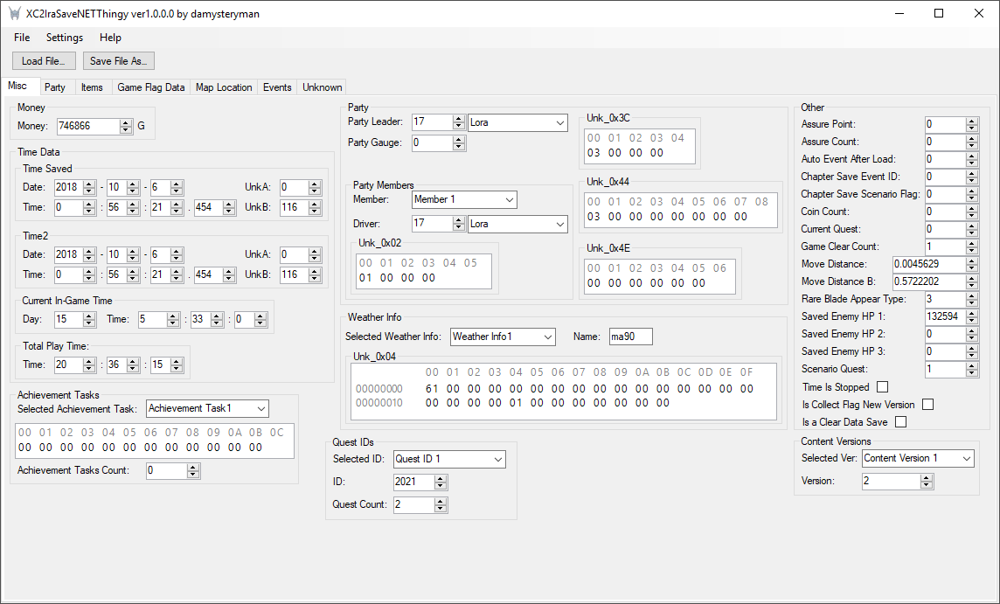
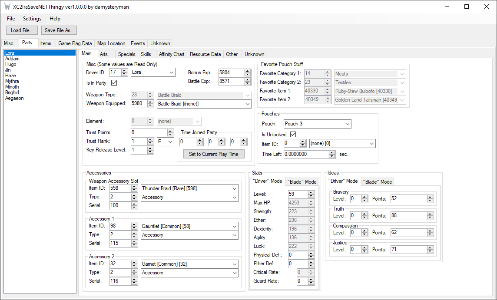
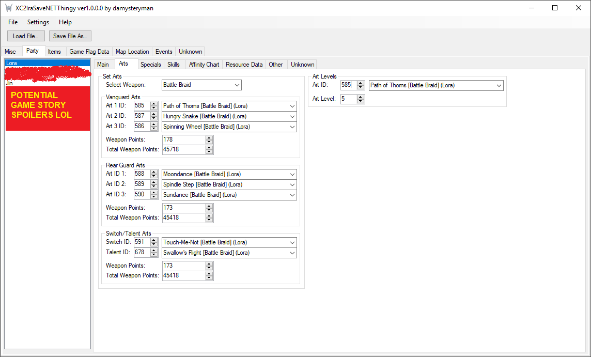
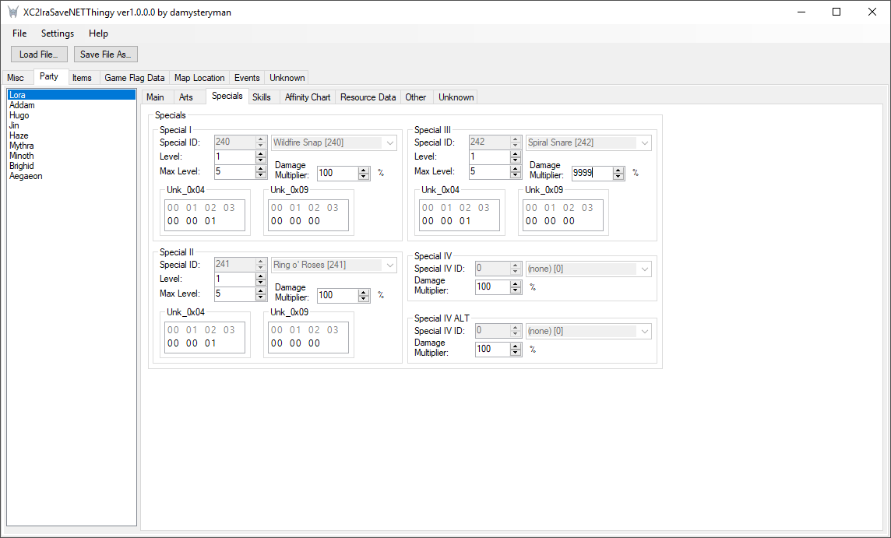
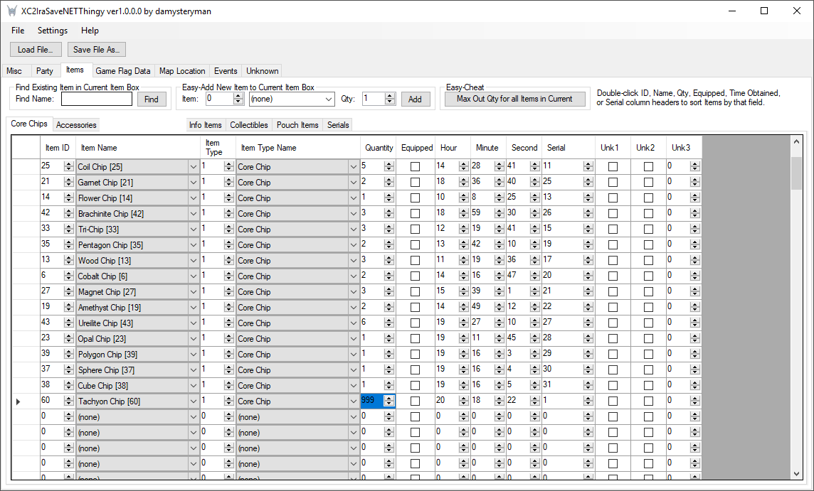

# XC2SaveNETThingy
## A Windows PC Save Editor package for Xenoblade Chronicles 2 + XC2 Torna The Golden Country Expansion

**WARNING! BACK UP YOUR SAVE FILES BEFORE MODIFYING THEM!**

### XC2Bf2SaveNETThingy - For Xenoblade 2 base game
This app can edit just about every byte of data in a Xenoblade Chronicles 2 Save File.

### XC2IraSaveNETThingy - For XC2 Torna The Golden Country Expansion
This app can change a lot of data in a XC2 Torna The Golden Country Save File.

These include changing data to values that could not normally be obtained via regular gameplay.

### XC2 3.0 compatibility
The shared save model accepts the 2.x/3.0 base-game and Torna save sizes without automatic version conversion. The 784-byte region at offset `0x117390` is exposed as `SaveVersion`; its first little-endian `UInt16` is available as `SaveVersionValue` and the remaining bytes are preserved verbatim.

Project data is generated from the 3.0U English `gb` language tables and the 3.0 Asian `cn`, `jp`, and `tw` tables. Torna event, quest, camp-event, battle-text, and dialogue BDAT files are retained as inputs for verification but are not imported because the current applications do not consume them. See [`tools/README.md`](tools/README.md) for reproducible generation and round-trip commands.

### Reserved item warnings
The shared database includes an `ItemStatus` table for 142 `Reserved` item records identified by the 3.0 multi-language BDAT comparison. The set includes empty names, `UNKNOWN_*` placeholders, English-table names that still contain Japanese, Chinese, or Korean characters, and explicit internal or provisional markers. These records remain selectable and writable so existing save-editing workflows are unchanged, but both editors append `[Reserved]`, use a red row warning, and show a tooltip explaining that the entry is retained game data that should be edited with care. The status is metadata only; it does not prove that the game accepts the item ID.

## Links:
Gitlab Repo - [https://gitlab.com/damysteryman/XC2SaveNETThingy]

Forum Thread - [https://gbatemp.net/threads/xc2savenetthingy-a-xenoblade-chronicles-2-save-editor.512217/]

## How to use:

### 0. Ensure you have Windows computer and Microsoft .NET Framework 4.6 installed.
This is a Windows app running on the .NET Framework, so you require a modern Windows system, and the [Microsoft .NET Framework 4.6](https://www.microsoft.com/net/download/dotnet-framework-runtime/net46) installed on your system.
Running under other environments under things like wine/mono have not been tested.

### 1. Extract/Obtain your save file.
First you must obtain your save file in some way, and get it from your Switch to your PC. A good way to do this is to use the [Checkpoint Save Manager Switch Homebrew App](https://github.com/BernardoGiordano/Checkpoint), or something similar.

### 2. BACK IT UP!
Before going any further, be sure to make a backup copy of your extracted save file, and store it in a safe place. This is just in case you change some data to values that the game itself does not like.

### 3. Load it into the app.
Start the app, then click the "Load Save File..." button to select and load your save file ("bf2savefile.sav" for base game save file, "irasavefile.sav" for Torna Expansion save file), and the file should be loaded into the program, provided there are no issues with it.

### 4. Edit stuff!
Edit whatever fields you want! Keep in mind that the game may react strangely after loading in save data with values that are not obtainable via normal gameplay.
(Not that it should stop you from trying and experimenting, let's see how far the game can be pushed! :P)

### 5. Save your edited file.
After you are done editing, click the "Save File As..." button to save your save data to a file. For the game to recognize it, the file needs to be called "bf2savefile.sav" for base game saves, or "irasavefile.sav" for Torna Expansion saves.

### 6. Restore the save file to the console.
After that, you must restore it back to your Switch console. Again, this can be done with the [Checkpoint Save Manager Switch Homebrew App](https://github.com/BernardoGiordano/Checkpoint), or something similar.

### 7. Load up the game and check thing out/see what happens.
Finally, load up the game and your save, and enjoy your changes/see your data altering experiments!

## NOTES:
1. The game can behave strangely in reaction to certain changes that are not normally possible in regular gameplay. The game could do a few different things in such a situation:
	* The game may be perfectly happy with your changes and run fine, changes and all
	* The game may refuse your changes and reset them back to what they were supposed to be, as if your edit was never done.
	* The game may try to run with your changes, only to not be programmed to handle your alterations and crash instead.
	* Remember, just because you have the power to alter the save data to whatever you want, does NOT mean that the game itself will be happy with everything you try to do!

2. There has been limited testing done on the results of save editing on the game's side of things. While some testing has been done to ensure that the editor does in fact modify the correct part of the save for each field in the app, since there are no "safety gloves" or "hand holding" regarding what data values are allowed or not, the alterations that this app can make have not necessarily been tested in-game, and thus, it is not yet known exactly how the game will react to modifying every single field that is editable, especially if modified to values that cannot be obtained via normal gameplay. If you wish to experiment with this sort of stuff, then by all means do so, and please report your findings if you like. But please do make sure to backup your save file beforehand if you care about it! (So far, this app has only been tested with saves from versions 1.3.0 and 1.5.0/1.5.1/1.5.2/2.0.0/2.0.1 of Base Game + DLC, and 1.0.0/1.0.1 of Torna The Golden Country. The 3.0 save verifier currently has only structural coverage until real 3.0 samples are supplied.)

## Some Screenshots
### XC2Bf2SaveNETThingy - For Xenoblade Chroniches 2 base game

### XC2IraSaveNETThingy - For XC2 Torna The Golden Country Expansion

